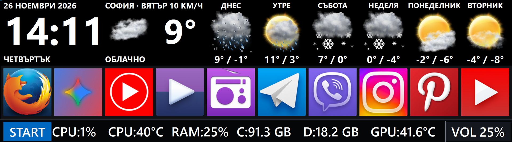
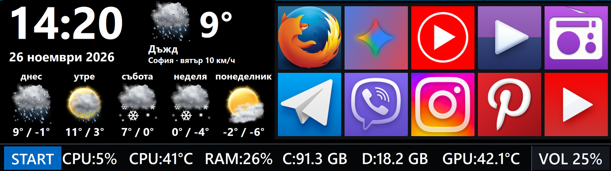

**English** | [Български](README.md)

# CorsairSuperWidget – widgets for the Corsair Xeneon Edge with AutoHotkey v2

One script that turns the **Corsair Xeneon Edge 14.5"** (2560×720), used as a regular secondary display **without iCUE**, into a dashboard:

- large clock, full date, current weather and a 5-day (`classic`) or 6-day (`wide`) forecast;
- launcher with 10 large app icons;
- bottom bar: **START**, CPU load and temperature, RAM, used space on two drives, GPU temperature, volume.

Everything is configured from a **Settings** window (right-click the tray icon) or from `settings.ini`.

**`wide`**



**`classic`**



*App logos in the screenshots belong to their respective owners.*
> The on-screen text (weekday/month names, weather descriptions, menus) is in Bulgarian; edit the strings in the script to translate.

## Two designs

| `Design=classic` | `Design=wide` |
|---|---|
| Clock and forecast on the left, 2 rows of 5 icons on the right | Top row: time, date, weather and 6-day forecast; the 10 icons in one row below |

Switch it in Settings → "Общи" (General). The bottom bar is the same in both.

## Requirements

- **Windows 11** and **AutoHotkey v2** (<https://www.autohotkey.com/>).
- The Edge as a **secondary display** (no iCUE), display scale **125%** (fonts are tuned for it).
- **HWiNFO64** for temperatures: right-click the CPU and GPU temperature sensors → *Report value in Gadget*. Without it the fields show `--`. HWiNFO and the script must run with the same privileges.
- Internet for the forecast ([Open-Meteo](https://open-meteo.com/), no API key).

## Installation

1. Download the folder and put it anywhere (e.g. `C:\CorsairSuperWidget\`).
2. Put the icons in `icons\` (see `icons\README.txt` – icons are **not included**, copyright / trademarks).
3. Double-click `CorsairSuperWidget.ahk`.
4. Right-click the tray icon → **Настройки…** (Settings) and adjust. The "Общи" tab has a "start with Windows" checkbox.

## Settings

`settings.ini` sits next to the script. If it is missing or a line is wrong, built-in defaults are used.

| Section | What it controls |
|---|---|
| `[General]` | `Design` (classic/wide), `AutoDetectScreen` (finds the smallest monitor), `ManualX`/`ManualY` (Edge position when auto-detect is off) |
| `[Paths]` | launcher icons folder, weather icons folder, Chrome apps (PWA) shortcuts folder; supports `%AppData%` and paths relative to the script |
| `[Weather]` | city (label), `Lat`, `Lon`, `RefreshMinutes` |
| `[Bar]` | `Drive1`, `Drive2`, `StrictTempLabels` |
| `[Volume]` | `WheelStep` – percent per wheel step |
| `[Launcher]` | `App1`…`App10`: `icon.png \| what to launch \| pwa (1/0) \| window title keyword` |

Window buttons: **Save and reload**, **Reset to defaults** (current file is kept as `settings.ini.bak`), **Restore previous** (swaps back the `.bak`).

### Finding the Edge coordinates
If auto-detection doesn't work, save this as `monitors.ahk` and run it:

```autohotkey
#Requires AutoHotkey v2.0
info := ""
Loop MonitorGetCount() {
    MonitorGet(A_Index, &l, &t, &r, &b)
    info .= "Monitor " A_Index ": X=" l "  Y=" t "  width=" (r - l) "  height=" (b - t) "`n"
}
MsgBox(info)
```
The line with width 2560 and height 720 gives `ManualX` and `ManualY`.

### Launcher
- First click starts the app and moves it to the **main** monitor; further clicks minimize/restore it.
- `cmd`: path to an `.exe`, a `.lnk`, `shell:AppsFolder\<AppID>` for Microsoft Store apps (PowerShell: `Get-StartApps`) or `http…`.
- `{ChromeApps}` in a command is replaced with the folder from `[Paths]`.

### Bar and volume
- START toggles the Windows Start menu. The mouse wheel over the **VOL** tile changes the volume; clicking it mutes/unmutes.
- Double-click the current temperature to refresh the forecast immediately.

## Troubleshooting

| Problem | What to check |
|---|---|
| Message about missing `07.png` | `icons\07.png` (weather icons) is missing |
| Launcher shows plain buttons | No PNG matching `App1…App10` in the `LauncherIcons` folder |
| Everything is in the wrong place | `AutoDetectScreen` / `ManualX` / `ManualY` |
| `CPU:--°C` / `GPU:--°C` | HWiNFO isn't running or isn't reporting the sensors to the Gadget |
| Error on start | AutoHotkey **v2** is required, not v1 |

## License and credits

- [AutoHotkey](https://www.autohotkey.com/), weather data from [Open-Meteo](https://open-meteo.com/) (see their terms).
- Weather icons: *Weather Touch* by *mohitg* (DeviantArt) – not part of the repo, check their license.
- App logos belong to their respective owners.
- Code license: *(choose one, e.g. MIT)*.
